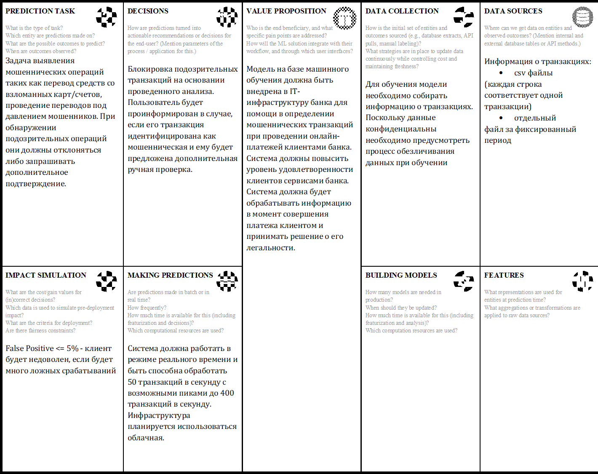

# otus-mlops-2026-10
### Учебный репозиторий для организации работ по проекту определения мошеннических финансовых операций
# Заказчик:
Коммерческий банк ООО "Лучший банк".

# Цели проекта:
Определение мошеннических операций при проведении онлайн-платежей клиентами банка;  
Блокировка подозрительных транзакций для дальнейшей ручной проверки.

# Ограничения:
Бюджет - до 10 млн.  

# Требования:
Ложные срабатывания: false positive <= 5% - чтобы избежать недовольства и оттока клиентов;   
Доля невыявленных мошеннических транзакций: не более 2 шт. на 100;  
Ущерб клиентов: не более 500 т.р. в месяц;  
Производительность: 50 транзакций в секунду с возможностью поддержать всплески до 400 транзакций в секунду.  

# Требования к инфраструктуре:
Облачная с возможностью масштабирования.

# Сроки:
3 месяца - разработка MVP для принятия решения о дальнейшем внедрении;  
6 месяцев с момента принятия положительного решения;

# Данные для обработки:
Транзакции хранятся в csv-файлах;  
Информация строго конфиденциальная.

# Оценка результата и выбор метрик:
Дата-сет не сбалансирован (то есть доля мошеннических операций значительно ниже, чем доля нормальных)  
Для определения качества работы системы предлагается использовать следующие метрики:  
**Precision (точность)** - доля действительно мошеннических транзакций среди всех, которые модель пометила как фрод >= 95%  
Нужно поддерживать высоким, чтобы не блокировать клиентов зря и не вызывать их отток.  
**Recall (полнота)** - доля выявленных мошеннических операций от общего числа реальных мошеннических операций >= 98% (пропуск не более 2 транзакций из 100)  
Не должна опускаться ниже заявленного уровня, чтобы поддерживать полноту отловленных мошеннических операций.

# Mission canvas:

# Основные функциональные части системы:  
Модуль сбора и обогащения данных  
Ядро анализа и принятия решений  
Модуль реагирования и управления действиями  
Постанализ и обучение системы  

